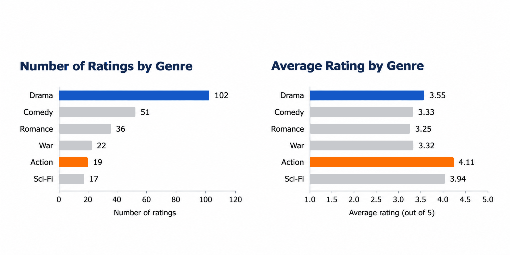
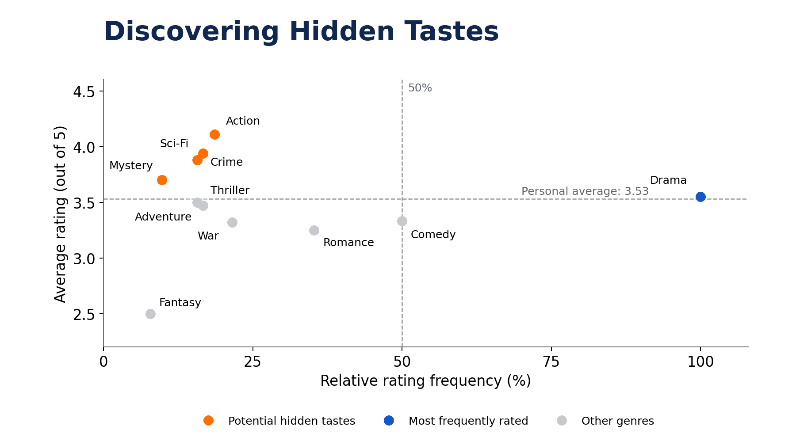
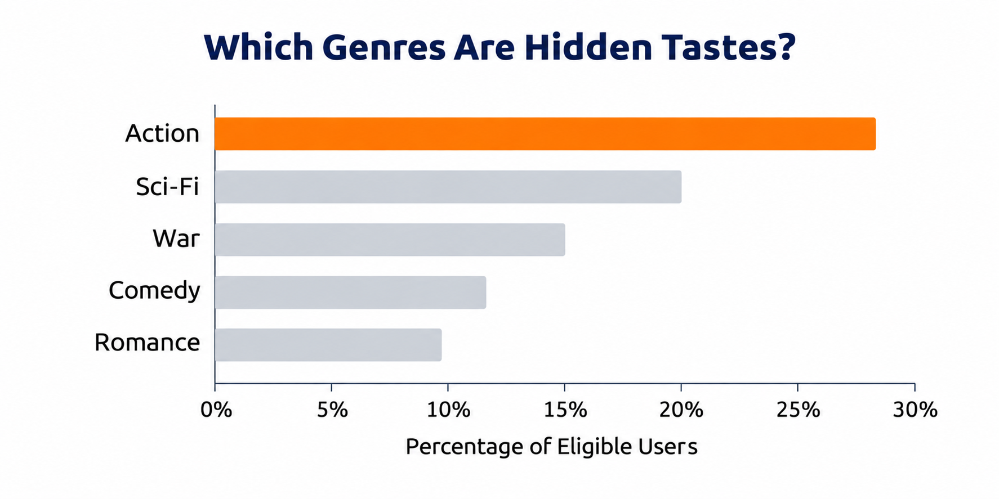

| [home page](https://cmustudent.github.io/tswd-portfolio-templates/) | [data viz examples](dataviz-examples) | [critique by design](critique-by-design) | [final project I](final-project-part-one) | [final project II](final-project-part-two) | [final project III](final-project-part-three) |

# The Hidden Taste
*Do our movie habits really reflect our preferences?*

# Outline

## High-level Summary
For this final project, I plan to explore the relationship between users' movie rating habits and their preferences, with a particular interest in how these insights can inform movie recommendation systems. The movie genres users interact with most frequently may not necessarily be the ones they enjoy the most. For example, in my preliminary analysis of the MovieLens 32M dataset, one user rated 102 drama movies with an average rating of 3.55, while rating only 19 action movies with a higher average rating of 4.11. This example raises an interesting question: if recommendations rely heavily on interaction frequency, could some of a user's interests be overlooked?

Using the MovieLens 32M dataset, I plan to examine how common this gap is among users by comparing their rating frequency and average rating across movie genres. I also want to identify potential hidden tastes, which I define as genres that users rate relatively infrequently but more positively than their personal average. Through this project, I hope to show recommendation system designers why it may be valuable to consider both established preferences and less-explored interests when developing personalized movie recommendations.

## Project Structure
**One-line Summary**: The movie genres we engage with most frequently may not always be the ones we enjoy the most.

**Target Audience**: Product managers, data analysts, and movie recommendation system designers.

**Reader's Perspective**: As a designer of movie recommendation systems, I want to understand how users' most frequently rated movie genres differ from their highest-rated genres so that I can identify overlooked interests and improve personalized recommendations.

**Call to Action**: Consider both frequently rated genres and less-explored but highly rated genres when designing personalized movie recommendations.

### An Outline

- **Introduction of the Topic**
  - Introduce the role of user interactions in movie recommendation systems.
  - Explain the difference between rating frequency and average rating.
  - Introduce the central question: Do our movie habits really reflect our preferences?

- **Explore the Preference Gap at the Individual Level**
  - Visualization 1: Show the number of ratings across movie genres for an individual user to identify their most frequently rated genres.
  - Visualization 2: Show the average rating of each genre for the same user and compare it with their rating frequency.
  - Highlight the differences between frequently rated genres and highly rated genres.

- **Expand the Analysis to a Broader Group of Users**
  - Visualization 3: Show the proportion of eligible users whose most frequently rated genres differ from their highest-rated genres.
  - Examine whether the preference gap is an isolated case or a common pattern among users.

- **Discover Potential Hidden Tastes**
  - Define hidden tastes as relatively infrequently rated genres with average ratings above a user's personal average, subject to a minimum number of ratings.
  - Visualization 4: Explore the relationship between relative rating frequency and average rating, highlighting potential hidden tastes.
  - Visualization 5: Identify which movie genres are most commonly associated with users' hidden tastes.
  - Discuss how these findings relate to the reader's perspective.

- **Call to Action**
  - Encourage movie recommendation system designers to consider less frequently rated but highly rated genres alongside users' established interests.
  - Discuss the potential for more diverse and personalized movie recommendations.
  - Conclude the story.

## Initial sketches

### Sketch 1: Exploring the Preference Gap at the Individual Level

These two bar charts compare an individual user's rating frequency and average rating across selected movie genres. I plan to use blue to highlight Drama, the user's most frequently rated genre, and orange to highlight Action, a less frequently rated but highly rated genre. Placing the charts side by side allows readers to easily identify the gap between rating habits and preferences.

### Sketch 2: How Common Is the Preference Gap?

This waffle chart will show the proportion of users whose most frequently rated genres differ from their highest-rated genres. I plan to use orange to represent users with a preference gap and gray to represent those without one. This visualization will help readers understand whether the preference gap is an isolated case or a common pattern among users.

### Sketch 3: Discovering Hidden Tastes

This scatter plot will explore the relationship between relative rating frequency and average rating. I plan to use orange to highlight genres that users rate less frequently but more positively than their personal average. The two reference lines will help readers identify potential hidden tastes.

### Sketch 4: Which Genres Are Hidden Tastes?

This horizontal bar chart will show the percentage of eligible users for whom each movie genre is identified as a potential hidden taste. I plan to arrange the genres in descending order and use orange to highlight the most common one, while keeping the remaining genres gray. This visualization will help recommendation system designers identify opportunities to introduce users to less-explored movie genres.

*Note: The genre rankings and percentages shown are illustrative and do not represent actual analysis results.*

# The data

For this project, I will use the MovieLens 32M dataset, provided by the GroupLens Research Group at the University of Minnesota. The dataset contains 32,000,204 ratings across 87,585 movies from 200,948 users, collected between January 1995 and October 2023. I will primarily use two files: `movies.csv`, which contains movie IDs, titles, and genres, and `ratings.csv`, which contains user IDs, movie IDs, ratings, and timestamps.

I plan to combine these two files using movie IDs and calculate the rating frequency and average rating for each genre at the individual user level. Since a movie can belong to multiple genres, I will associate each rating with all its listed genres and exclude movies without genre information. To identify potential hidden tastes, I plan to focus on genres with at least five ratings, a rating frequency no more than 50% of the user's most frequently rated genre, and an average rating above the user's personal average. These criteria will help me identify less frequently rated but positively rated genres while reducing the influence of limited rating observations.

One limitation of this dataset is that it captures rating behavior rather than actual viewing history. Therefore, I will use rating frequency and average ratings as indicators of users' habits and preferences rather than direct measures of their viewing behavior.

## Data Source

| Name | URL | Description |
|------|-----|-------------|
| MovieLens 32M Dataset | [GroupLens](https://grouplens.org/datasets/movielens/32m/) | Official dataset containing movie ratings and genre information. |
| MovieLens 32M Data Files | [Download Dataset](https://files.grouplens.org/datasets/movielens/ml-32m.zip) | Downloadable ZIP file containing movies.csv, ratings.csv, and other supporting files. |
| MovieLens 32M Documentation | [README](https://files.grouplens.org/datasets/movielens/ml-32m-README.html) | Documentation of the dataset structure, collection process, and usage conditions. |

# Method and medium

I plan to use Python (Pandas) to clean, combine, and analyze the MovieLens 32M dataset. I will use Tableau to create interactive visualizations that allow readers to explore the relationship between users' rating habits and preferences. For the final presentation, I plan to use Shorthand to combine visualizations and narrative text into a interactive data story. I will also use GitHub to document my project development process and share the final project.

## References

- GroupLens Research. (2024). [MovieLens 32M Dataset](https://grouplens.org/datasets/movielens/32m/). University of Minnesota.
- Harper, F. M., & Konstan, J. A. (2015). The MovieLens Datasets: History and Context. *ACM Transactions on Interactive Intelligent Systems, 5*(4), 19:1–19:19. [https://doi.org/10.1145/2827872](https://doi.org/10.1145/2827872)

## AI acknowledgements

I used ChatGPT to help refine my research questions, organize the story structure, and develop Python code for preliminary data analysis. I also used ChatGPT to improve the clarity, wording, and grammar of my written content.
