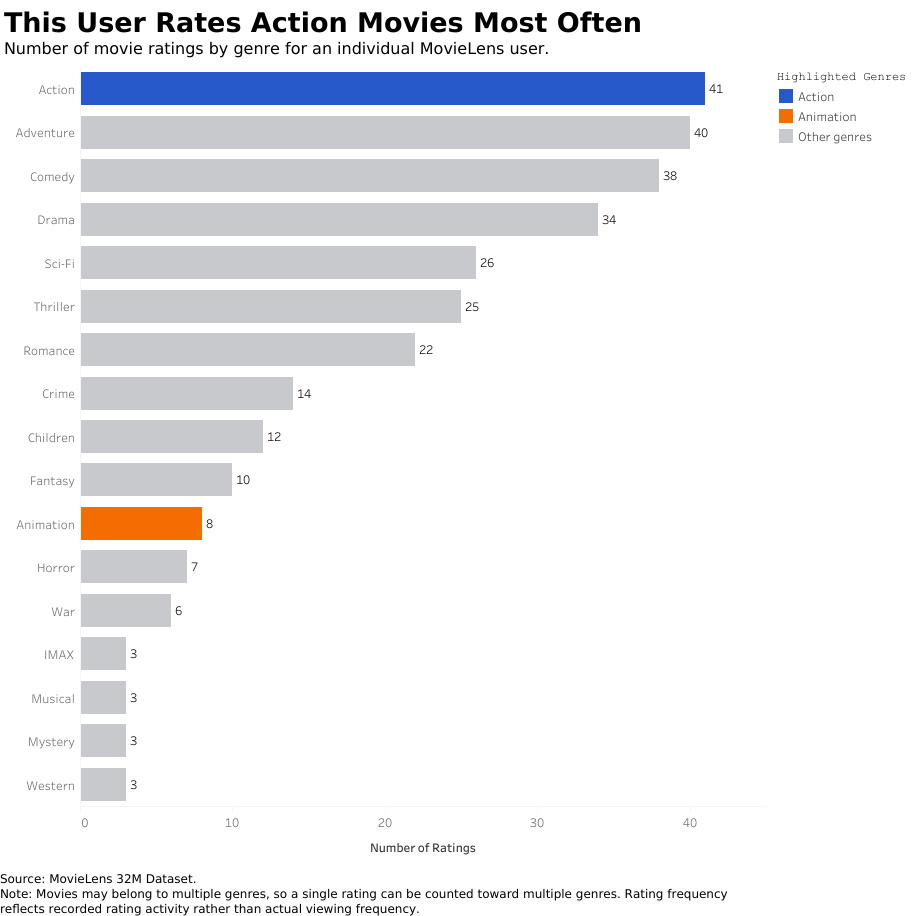
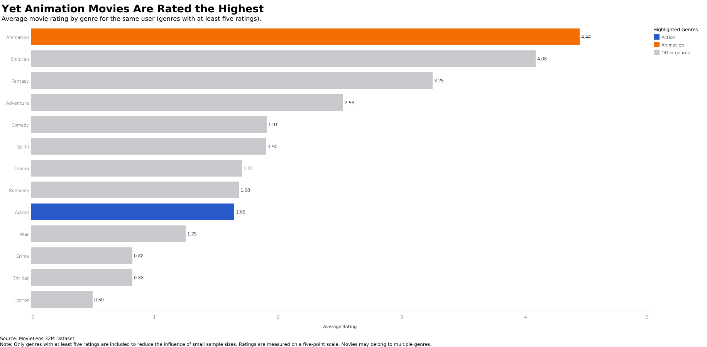
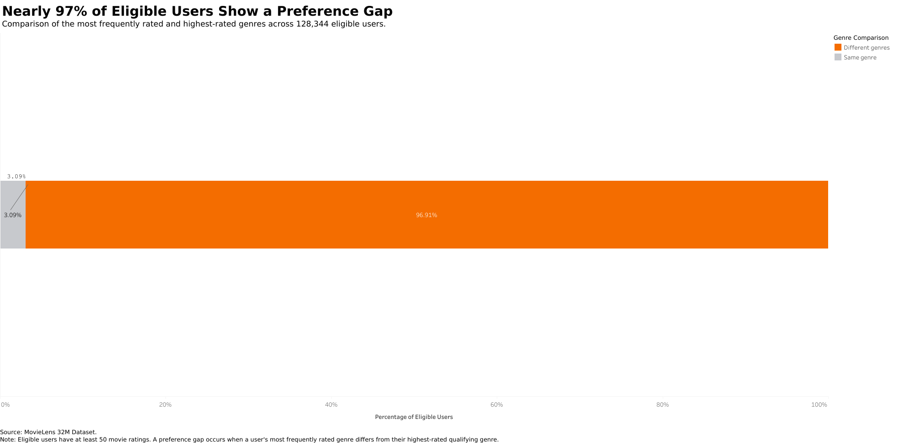
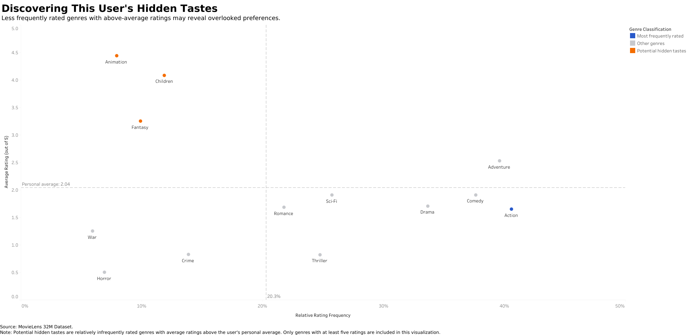
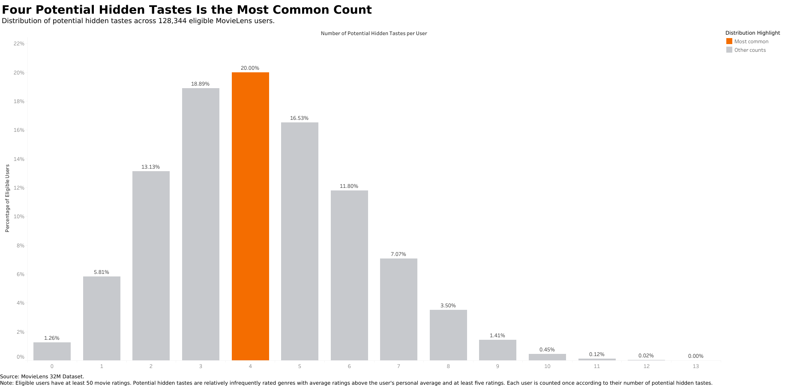

| [home page](https://hkuo07.github.io/hkuo07-portfolio/) | [data viz examples](dataviz-examples) | [critique by design](critique-by-design) | [final project I](final-project-part-one.md) | [final project II](final-project-part-two.md) | [final project III](final-project-part-three) |

# The Hidden Taste

*Do our movie rating habits really reflect our preferences?*

# Wireframes / Storyboards

## Project Overview

The movie genres users rate most frequently may not necessarily be the ones they enjoy the most. My project explores the relationship between rating frequency and average ratings to identify potential hidden tastes and examine how these findings could inform personalized movie recommendations.

### Reader's Perspective

As a designer of movie recommendation systems, I want to understand the gap between users' rating habits and preferences so that I can identify potential interests that may otherwise be overlooked.

### Data and Methodology

I used the ratings.csv and movies.csv files from the MovieLens 32M dataset, processed the data using Python, and created the visualizations using Tableau.

The population-level analysis includes 128,344 eligible users with at least 50 movie ratings. A minimum of five ratings per genre is required when identifying potential hidden tastes.

Since movies can belong to multiple genres, a single rating may contribute to more than one genre. Rating frequency represents recorded rating activity rather than actual viewing frequency.

## Refinement Based on Part I Feedback

Based on the feedback I received in Part I, I developed my initial sketches into high-fidelity visualizations using actual data. I also strengthened the connection between my analytical findings and their practical applications by introducing an alternative recommendation strategy that considers both rating frequency and potential hidden tastes.

## Storyboard and Draft Visualizations

The story begins with an individual example, expands to population-level findings, and concludes with a proposed recommendation strategy.

### 1. Understanding Rating Habits

Let's begin with an individual MovieLens user. Action is the user's most frequently rated genre, with 41 ratings, while Animation has received only eight ratings.

If recommendations rely heavily on rating frequency, Action may appear to be a stronger interest. But does this user's rating activity actually reflect their preferences?

### 2. Revealing the Preference Gap

Looking at the same user's average ratings reveals a different picture. Action has an average rating of only 1.65 out of 5, while Animation has the highest average rating among qualifying genres, at 4.44.

This contrast suggests that rating frequency alone may not fully capture a user's preferences. But is this difference unique to this individual?

### 3. Looking Beyond One User

To examine how common this preference gap is, I compared the most frequently rated genre with the highest-rated qualifying genre for each eligible user.

The results show that 96.91% of eligible users have different first-ranked genres under these two measures. Although this does not demonstrate dissatisfaction with existing recommendation systems, it suggests that rating frequency and average ratings capture different aspects of user preferences.

### 4. Discovering Hidden Tastes

Returning to the individual example, I examined both measures together to identify potential hidden tastes: relatively infrequently rated genres with average ratings above the user's personal average and at least five ratings.

Animation, Children, and Fantasy stand out as three potential hidden tastes. These genres receive relatively few ratings but have average ratings above the user's personal average of 2.04.

### 5. Understanding the Broader Opportunity

I then examined the distribution of potential hidden tastes across the eligible MovieLens population.

Four potential hidden tastes is the most common outcome. The individual introduced earlier, with three potential hidden tastes, also falls within one of the more common groups.

This suggests that overlooked interests may extend beyond a single genre.

### 6. Rethinking Movie Recommendations

What if recommendation systems considered both rating habits and potential hidden tastes?

For the individual introduced earlier, a frequency-based strategy might prioritize Action while overlooking Animation. Instead of recommending four Action movies, an alternative strategy could recommend two Action movies and two Animation movies.

This illustrative strategy considers both rating habits and potential hidden tastes. Future A/B testing could evaluate whether it improves user satisfaction, engagement, or movie discovery.

### Call to Action

**Consider both frequently rated genres and less frequently rated but highly rated genres when designing personalized movie recommendations.**

---

# User Research

## Target Audience and Participant Selection

My target audience is movie recommendation system designers, including data analysts, data scientists, and product managers working with user behavior data and personalized recommendations.

I focused on graduate students with professional backgrounds in information systems, business analytics, and project management. Although they may not work directly on recommendation systems, their experiences provide relevant perspectives on visual communication, analytical credibility, and decision-making.

## Interview Script

### Research Goal

The goal of my research is to evaluate whether the visualizations are intuitive, the story flows logically, the findings are convincing, and the proposed recommendation strategy is relevant to the intended audience.

### Introduction

Thank you for participating in my user research. My project explores whether movie rating habits reflect users' preferences and how potential hidden tastes could inform movie recommendations.

I will show you my draft story and ask several questions. I am evaluating the clarity of my story, not your knowledge of data visualization. Please feel free to share any confusion, observations, or suggestions.

### Research Goals and Interview Questions

| Goal | Questions to Ask |
|------|------------------|
| Evaluate understanding of the main concept. | What differences do you notice between rating frequency and average ratings in the first two visualizations? |
| Assess the clarity and credibility of the findings. | What does the percentage in Visualization 3 mean to you? Is the result convincing? |
| Evaluate understanding of potential hidden tastes. | How would you explain the different regions of the scatter plot? Is anything unclear? |
| Assess the effectiveness of the distribution chart. | What is your main takeaway from Visualization 5? |
| Evaluate practical relevance. | What do you think about the proposed recommendation strategy? |
| Evaluate the story structure. | Is the overall story easy to follow? Are any sections confusing or disconnected? |
| Identify visual design improvements. | Are there any colors, titles, labels, or other visual elements you would change? |
| Identify additional audience needs. | What additional information would make this story more useful to recommendation system designers? |

### Closing

Thank you for your feedback. Your responses will help me improve the visualizations and refine my final data story.

---

## Interview Findings

The following findings summarize the participants' observations and suggestions. All participants are described anonymously.

### Participant 1

**Background:** A female MISM graduate student with professional experience in supply chain management and web development.

She found the story logical and easy to follow, particularly the connection between the first two visualizations.

**Key feedback:**

- Suggested using colors that are more closely associated with movie genres, such as a more intense color for Action and a more playful color for Animation.
- Recommended highlighting important keywords in longer subtitles, such as "individual."
- Suggested replacing the stacked bar chart in Visualization 3 with a waffle chart to make the percentage more intuitive.
- Felt that Visualization 5 contained too many percentage labels and suggested moving the x-axis title below the chart.
- Recommended adding a small person icon above the bar representing three potential hidden tastes to connect the individual example in Visualization 4 with the broader distribution.

### Participant 2

**Background:** A male MISM-BIDA graduate student with professional experience in business analytics.

He found the story clear and easy to follow but identified opportunities to simplify the visualizations and improve analytical transparency.

**Key feedback:**

- Suggested reducing the number of genres displayed in Visualizations 1 and 2 to emphasize the main comparison.
- Recommended clarifying that Visualization 3 compares the first-ranked genre under each measure.
- Questioned whether the percentage of nearly 97% was "too good to be real."
- Suggested comparing the top three genres under each measure instead of only the first-ranked genres to examine whether the findings remain consistent under a different ranking approach.

### Participant 3

**Background:** A female MISM graduate student with professional experience in project management.

She found the visualizations intuitive and the overall story smooth and easy to follow. Her suggestions focused on readability and reducing visual clutter.

**Key feedback:**

- Suggested increasing the font size of the percentages in Visualization 3 to make the key findings easier to read.
- Liked the concept of Visualization 4 and found the different quadrants easy to understand. However, she felt that displaying labels for all genres made the scatter plot somewhat cluttered.
- Felt that Visualization 5 contained too many percentage labels and suggested reducing unnecessary numerical information.

## Research Synthesis

All three participants found the overall story clear and logical, suggesting that the existing story structure is effective.

Reducing visual clutter was a recurring theme. Participant 2 suggested displaying fewer genres in the first two visualizations, while Participant 3 recommended simplifying the genre labels in the scatter plot. Participants 1 and 3 also independently suggested removing unnecessary percentage labels from Visualization 5.

Their feedback on Visualization 3 was particularly interesting. Participant 1 suggested changing the chart type, Participant 2 questioned the analytical methodology, and Participant 3 recommended increasing the font size of the percentages.

These different perspectives helped me recognize that an effective visualization needs to communicate findings clearly, establish trust in the underlying analysis, and guide readers toward the most important information.

---

# Identified Changes for Part III

Based on the interview findings, I plan to maintain the existing story structure while addressing the following issues.

| Research Synthesis | Anticipated Changes for Part III |
|--------------------|----------------------------------|
| Participant 1 suggested more genre-related colors and clearer subtitles. | Explore alternative colors while maintaining consistency, and emphasize important keywords in subtitles. |
| Participant 2 felt that Visualizations 1 and 2 contained too many genres. | Reduce less relevant categories and emphasize the comparison between Action and Animation. |
| Participant 1 suggested an alternative chart type for Visualization 3. | Explore a waffle chart and compare its effectiveness with the current stacked bar chart. |
| Participant 2 questioned the high percentage in Visualization 3. | Clarify the first-ranked genre comparison, minimum rating requirements, and treatment of tied rankings. |
| Participant 2 suggested comparing the top three genres. | Examine the overlap between the top three most frequently rated and highest-rated genres to evaluate the influence of the ranking methodology. |
| Participant 3 found the percentages in Visualization 3 difficult to read. | Increase the font size of the key percentages. |
| Participant 3 liked the quadrant structure of Visualization 4 but found the genre labels cluttered. | Retain the quadrant structure and data points while displaying labels only for the most relevant genres. |
| The analytical definitions in Visualization 4 need to be consistent. | Review the relative rating frequency calculation, reference lines, and explanatory notes. |
| Participants 1 and 3 found the percentage labels in Visualization 5 excessive. | Remove unnecessary labels while retaining the percentage for the most common outcome. |
| Participant 1 suggested adjusting the x-axis title in Visualization 5. | Move the x-axis title below the chart. |
| Participant 1 suggested connecting the individual example with the broader distribution. | Add a small person icon or annotation above the bar representing three potential hidden tastes. |

My main priorities for Part III are to improve visual clarity, analytical transparency, and the connections between visualizations while maintaining the practical relevance of the story to recommendation system designers.

---

## References

- [GroupLens Research – MovieLens 32M Dataset](https://grouplens.org/datasets/movielens/32m/)
- [Tableau](https://www.tableau.com/)

## AI Acknowledgements

I used ChatGPT to help refine my research questions, develop Python code for data processing, organize the story structure, and explore alternative visualization designs.

ChatGPT also helped me develop the interview protocol, organize my interview notes, synthesize feedback, draft and edit the written narrative, and structure the GitHub Markdown page.

I provided the project concept, research direction, participant feedback, and design preferences. I used Python to process the MovieLens dataset and Tableau to create the five draft visualizations.
