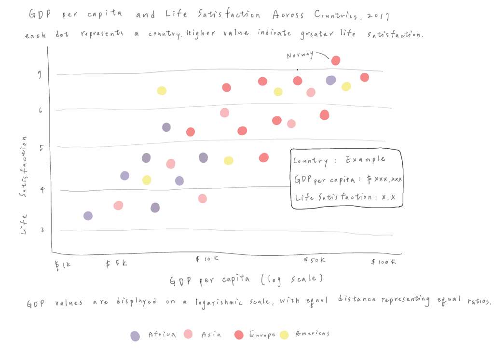

# Makeover Monday: GDP per Capita vs. Life Satisfaction

## Introduction

For this assignment, I selected a visualization from Makeover Monday that explores the relationship between GDP per capita and life satisfaction across countries in 2017.

The original visualization shows a positive relationship between GDP per capita and life satisfaction. However, some country labels overlap, and the different circle sizes are not clearly explained. The logarithmic scale on the x-axis may also be difficult for readers to understand.

My goal is to redesign the visualization to make it easier to compare countries, identify regional patterns, and understand the relationship between GDP per capita and life satisfaction.

## Original Visualization and Data Source

The original visualization, *Self-reported Life Satisfaction vs. GDP per Capita (2017)*, was published by Our World in Data and featured in Makeover Monday.

The chart compares GDP per capita and self-reported life satisfaction across countries in 2017.

**Original Visualization**: [Our World in Data – Self-reported life satisfaction vs. GDP per capita](https://ourworldindata.org/happiness-and-life-satisfaction)

**Data Source**: Our World in Data, using GDP per capita and life satisfaction data.

## Critique of the Original Visualization

### Strengths

The original visualization clearly shows a positive relationship between GDP per capita and life satisfaction. The axis labels help readers understand what is being compared, while the different colors make it easier to identify regional patterns.

### Weaknesses

One issue is that many country labels overlap, making it difficult to identify individual countries. The circles also have different sizes, but their meaning is not clearly explained. In addition, the logarithmic scale on the x-axis may be confusing for readers who are unfamiliar with this type of scale.

### Redesign Goals

My goal is to make the visualization easier to read and compare. I plan to use circles of the same size, label only selected countries, and provide additional information through tooltips. I also want to make the logarithmic scale clearer and use consistent regional categories to help readers compare countries.

## Wireframe and Initial Redesign

Before creating the visualization in Tableau, I sketched a wireframe to plan how I wanted to improve the original chart.

In my redesign, I decided to use circles of the same size and label only a few selected countries to reduce clutter. I also planned to include tooltips so readers could explore individual countries without displaying too much information on the chart.

I kept the logarithmic scale for GDP per capita but wanted to make it clearer through the axis label. I also planned to use six continent categories to help readers compare regional patterns.

### Initial Wireframe

The sketch below shows my initial plan for the redesigned visualization.

## Peer Testing and Feedback

I shared my visualization with two participants:

**Participant 1**: MAM student with experience in arts education and fundraising.

**Participant 2**: MISM-BIDA student with previous experience as a business analyst.

### Key Feedback

**Strengths**: Both participants recognized the positive relationship between GDP per capita and life satisfaction. The chart was easy to read.

**Colors**: Too many colors made it difficult to focus on the main message.

**Country Labels**: The purpose of highlighting specific countries was unclear.

**Title**: The main takeaway could be communicated more clearly.

### Planned Improvements

Based on their feedback, I plan to revise the title to emphasize that countries with higher GDP per capita generally report higher life satisfaction. Instead of using six different colors to represent continents, I plan to show most countries in light gray and use a contrasting color to highlight a few countries that illustrate exceptions to this relationship. I also plan to add short annotations explaining how these countries differ from the general pattern, so readers can understand why they were selected.

## Final Redesign in Tableau
After receiving feedback from my two peers, I revised my visualization to make the main message clearer and reduce unnecessary distractions. I changed the title to highlight the positive relationship between GDP per capita and life satisfaction. Instead of using different colors to represent continents, I changed most data points to gray and used orange to highlight only the countries relevant to my story. I also adjusted the y-axis range from 0–8 to 2–8 to reduce empty space while keeping the scale visible.

I decided to focus on Costa Rica and Botswana because they have nearly identical GDP per capita ($15,525 and $15,807), but very different life satisfaction scores (7.23 and 3.50). I added an annotation to highlight this 3.73-point difference and explain why these two countries are worth comparing. These changes help readers see the overall positive relationship while also recognizing that GDP per capita alone does not fully explain differences in life satisfaction.

### Final Visualization

[View my final visualization on Tableau Public](https://public.tableau.com/app/profile/joy.kuo6896/viz/1_17945133428230/GDPperCapitavs_LifeSatisfaction2017?publish=yes)

